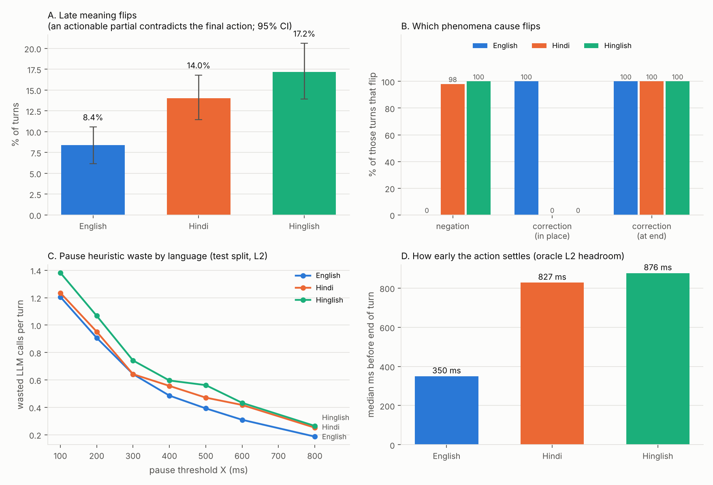
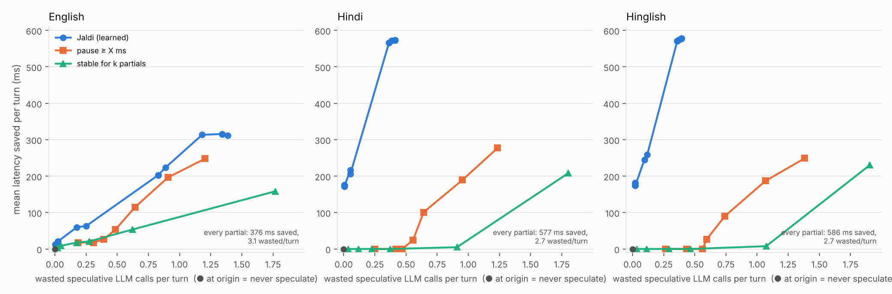
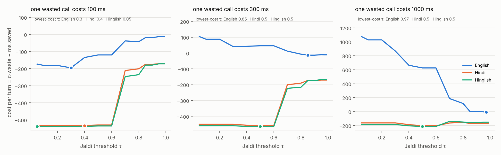
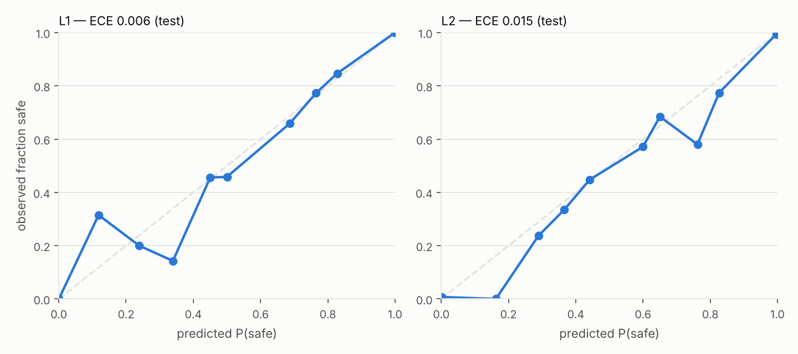

# Jaldi — when can a voice agent start answering before you finish?

Every cascaded voice agent (STT → LLM → TTS) pays its LLM and TTS time **after** the caller stops
talking. The known trick is **speculative generation**: start the LLM on a partial transcript,
keep the result if the final transcript still says the same thing, throw it away if not. Done
blindly it either wastes LLM calls or leaves latency on the table.

**Jaldi learns the policy:** at every streaming partial, a small calibrated model predicts
*"would the answer I generate now be the same as the answer from the final transcript?"*
Fire early if yes, wait if no.

```
partial transcript ──► causal features ──► calibrated P(safe) ──► speculate / wait
 (every 200 ms)        text cues                LightGBM            commit at end of turn
                       ASR stability            + isotonic          if still valid,
                       pause / prosody                              else discard (waste)
                       turn-detector score
```

## Why Indian languages are interesting here

Hindi and Kannada are verb-final (SOV). The words that change meaning often arrive last:

> "mujhe kal ki booking cancel… **nahi** karni hai"

So the hypothesis was: speculation heuristics tuned on English will misfire more on Hindi/Hinglish.
The smoke run below already shows it is more nuanced than that. Verb-final order adds **risk**
(negation after the verb) *and* **opportunity**: the action is often settled at the verb, before
trailing auxiliaries like "karni hai", which gives a learned policy more room to start early.

## Results

<!-- RESULTS:START -->
> **Smoke run.** Template corpus + *simulated* streaming partials (no audio, no ASR) + rule-based action labels. These numbers show the pipeline works end to end and how the templates behave. They are **not** evidence about real callers or real ASR. Real numbers come from the GPU run (`notebooks/gpu_stages.ipynb`).

Run: mode=`text_sim`, labels=`rule`, 1800 turns (train/val/test = 958/273/569, scenario- and speaker-disjoint). Final action from final transcript matches gold on 100.0% of turns. Time-to-ready assumed 600 ms, endpointing delay 500 ms.

### What the numbers say

- Late meaning flips: Hindi 14.0% vs English 8.4% (higher; 95% CIs do not overlap).
- Late meaning flips: Hinglish 17.2% vs English 8.4% (higher; 95% CIs do not overlap).
- Negation turns that flip: English 0.0%, Hindi 98.0%, Hinglish 100.0%. In these templates English states negation before the verb; Hindi/Hinglish after it.
- Opportunity runs the other way: median L2 headroom English 350 ms, Hindi 827 ms, Hinglish 876 ms (the action settles at the verb, before trailing auxiliaries like "करनी है").
- English-tuned pause heuristic (X=400 ms, tuned under ≤ 0.5 wasted calls/turn): English 53 ms saved / 0.49 wasted, Hindi 25 ms saved / 0.56 wasted, Hinglish 27 ms saved / 0.60 wasted. Pauses here follow one distribution for every language, so a pause rule cannot see word order: it neither avoids the negation flips nor uses the extra headroom.
- Jaldi (τ=0.7, tuned under ≤ 0.25 wasted calls/turn) saves English 63 ms, Hindi 216 ms, Hinglish 258 ms per turn on average.
- L1 gate (model 95% CI lower bound > best single heuristic 95% CI upper bound): PASSED vs pause (silence_ms).
- L2 gate (model 95% CI lower bound > best single heuristic 95% CI upper bound): PASSED vs pause (silence_ms).

### M1: meaning flips by language



| language | turns | late meaning-flip rate [95% CI] | false-actionable rate | median L1 headroom | median L2 headroom |
|---|---|---|---|---|---|
| English | 634 | 8.4% [6.2, 10.6] | 46.4% | 266 ms | 350 ms |
| Hindi | 613 | 14.0% [11.4, 16.8] | 29.0% | 274 ms | 827 ms |
| Hinglish | 553 | 17.2% [13.9, 20.6] | 29.5% | 266 ms | 876 ms |

### Policies: latency saved vs wasted calls (test split)



Action-safe (L2) speculation, settings tuned on val under ≤ 0.25 wasted calls/turn:

| policy | param | English saved ms / wasted per turn | Hindi saved ms / wasted per turn | Hinglish saved ms / wasted per turn | all: p50 / p90 latency (ms) |
|---|---|---|---|---|---|
| pause (tuned on English val) | 800 | 18 / 0.19 | 0 / 0.25 | 0 / 0.26 | 1100 / 1100 |
| pause (tuned on all-language val) | 800 | 18 / 0.19 | 0 / 0.25 | 0 / 0.26 | 1100 / 1100 |
| stable (tuned on all-language val) | 4 | 18 / 0.18 | 0 / 0.22 | 0 / 0.29 | 1100 / 1100 |
| Jaldi (tuned on all-language val) | 0.7 | 63 / 0.25 | 216 / 0.05 | 258 / 0.12 | 1032 / 1100 |

Action-safe (L2) speculation, settings tuned on val under ≤ 0.5 wasted calls/turn:

| policy | param | English saved ms / wasted per turn | Hindi saved ms / wasted per turn | Hinglish saved ms / wasted per turn | all: p50 / p90 latency (ms) |
|---|---|---|---|---|---|
| pause (tuned on English val) | 400 | 53 / 0.49 | 25 / 0.56 | 27 / 0.60 | 1096 / 1100 |
| pause (tuned on all-language val) | 500 | 26 / 0.39 | 0 / 0.47 | 0 / 0.56 | 1100 / 1100 |
| stable (tuned on all-language val) | 3 | 21 / 0.27 | 0 / 0.37 | 0 / 0.47 | 1100 / 1100 |
| Jaldi (tuned on all-language val) | 0.7 | 63 / 0.25 | 216 / 0.05 | 258 / 0.12 | 1032 / 1100 |

Action-safe (L2) speculation, settings tuned on val under ≤ 1.0 wasted calls/turn:

| policy | param | English saved ms / wasted per turn | Hindi saved ms / wasted per turn | Hinglish saved ms / wasted per turn | all: p50 / p90 latency (ms) |
|---|---|---|---|---|---|
| pause (tuned on English val) | 100 | 248 / 1.21 | 277 / 1.24 | 249 / 1.38 | 826 / 1100 |
| pause (tuned on all-language val) | 200 | 196 / 0.91 | 189 / 0.95 | 187 / 1.07 | 905 / 1006 |
| stable (tuned on all-language val) | 2 | 53 / 0.62 | 5 / 0.91 | 8 / 1.07 | 1100 / 1100 |
| Jaldi (tuned on all-language val) | 0.3 | 313 / 1.18 | 574 / 0.41 | 577 / 0.39 | 500 / 898 |

Transcript-safe (L1) speculation, tuned under ≤ 1.0 wasted calls/turn:

| policy | param | English saved ms / wasted per turn | Hindi saved ms / wasted per turn | Hinglish saved ms / wasted per turn | all: p50 / p90 latency (ms) |
|---|---|---|---|---|---|
| pause (tuned on English val) | 200 | 158 / 1.05 | 141 / 1.35 | 136 / 1.44 | 941 / 1100 |
| pause (tuned on all-language val) | 300 | 78 / 0.75 | 82 / 0.93 | 70 / 1.02 | 1031 / 1100 |
| stable (tuned on all-language val) | 6 | 0 / 0.02 | 0 / 0.04 | 0 / 0.03 | 1100 / 1100 |
| Jaldi (tuned on all-language val) | 0.05 | 223 / 0.97 | 243 / 0.63 | 225 / 0.66 | 841 / 1100 |

Cost view (oracle τ per language, illustration only):



### Model

| label | test base rate | AUROC [95% CI, turn bootstrap] | seed std | ECE | Brier | best single heuristic AUROC |
|---|---|---|---|---|---|---|
| L1 | 14.1% | 0.994 [0.993, 0.994] | 0.0001 | 0.006 | 0.023 | pause (silence_ms): 0.912 [0.904, 0.919] |
| L2 | 26.2% | 0.960 [0.955, 0.965] | 0.0006 | 0.015 | 0.066 | pause (silence_ms): 0.713 [0.703, 0.723] |

Per-language AUROC: L1 English 0.986, Hindi 0.996, Hinglish 0.997; L2 English 0.910, Hindi 0.977, Hinglish 0.979.

Ablation (test AUROC, one feature group removed):

| label | without_text | without_stability | without_acoustic | without_meta | all_features |
|---|---|---|---|---|---|
| L1 | 0.986 | 0.993 | 0.976 | 0.994 | 0.994 |
| L2 | 0.898 | 0.964 | 0.949 | 0.961 | 0.964 |

Features unavailable in this run (all NaN, dropped): `asr_conf, f0_slope, energy_drop, turn_p`.



Time-to-ready sensitivity (L2, mean ms saved per turn at the selected settings):

| policy | TTR 300 ms (En/Hi/Hi) | TTR 600 ms (En/Hi/Hi) | TTR 1000 ms (En/Hi/Hi) |
|---|---|---|---|
| pause (tuned on English val) | 9 / 0 / 0 | 18 / 0 / 0 | 29 / 0 / 0 |
| pause (tuned on all-language val) | 9 / 0 / 0 | 18 / 0 / 0 | 29 / 0 / 0 |
| stable (tuned on all-language val) | 9 / 0 / 0 | 18 / 0 / 0 | 25 / 0 / 0 |
| Jaldi (tuned on all-language val) | 60 / 146 / 170 | 63 / 216 / 258 | 63 / 242 / 304 |
<!-- RESULTS:END -->

## How it works

**Labels (free in production).** For each partial:
- **L1 transcript-safe:** normalized partial == final transcript. A speculation from here is reusable as is.
- **L2 action-safe:** the action `{intent, polarity, slots}` extracted from the partial == the action
  extracted from the final transcript.

Every production call log already contains interim and final transcripts, so both labels can be
computed from a company's own logs with no annotation.

**Features (causal: only what is known at that moment).**
- **Text cues:** ends with a verb / light verb / auxiliary / negation / postposition / conjunction / filler,
  tokens since the verb, code-mix ratio.
- **ASR stability:** edit distance to the previous partial, recent revisions, ms since the last change.
- **Pause and prosody:** silence so far, speaking rate, F0 slope and energy drop over the last 300 ms.
- **Turn-detector probability:** from an open model.

Unit tests check that no feature reads the future.

**Model.** LightGBM, 5 seeds, isotonic calibration on a held-out scenario, separate heads for L1
and L2. Splits are scenario-disjoint (test scenarios never seen in training) and speaker-disjoint.

**Policy simulation.** Each test turn is replayed in time:
1. Speculate at the first partial where P(safe) ≥ τ.
2. Discard the speculation if a later partial changes the transcript (L1) or the action (L2). This is waste.
3. At end of turn, commit if the speculation is still valid. Saved = min(time-to-ready, end of turn − start).

Baselines: never, every partial, pause ≥ X ms, stable for k partials, turn detector ≥ τ.

## Beyond cascades

Speech-to-speech models skip the intermediate transcript but still decide *when to commit to
speaking*. Whether a learned commit policy helps there is an open question, not a claim of this repo.

## Limitations (read before quoting any number)

- **Smoke-run numbers come from a template corpus with simulated partials.** Templates make text
  cues nearly deterministic, so model AUROC there is far higher than real speech would give. Use
  them to check the pipeline and the shape of the result, not its size.
- **Synthetic voices with inserted pauses** (GPU run) are not real callers. Pause placement follows
  one distribution for every language by design.
- **Partials come from re-decoding the audio prefix every 200 ms**, not from a true streaming
  recognizer. `jaldi/asr/streaming_api.py` holds the fidelity check against a real streaming API.
- **Labels depend on a single extractor:** rule-based in the smoke run, one open LLM in the GPU run.
- **Scenarios are generic and few** (6). **Time-to-ready is assumed** (600 ms) unless measured with
  `jaldi measure-ttr`.

## Reproduce

```bash
pip install -e ".[dev]"
python -m jaldi.cli all          # CPU smoke run: corpus → simulated partials → labels → M1 → features → model → policies → README
pytest -q
```

GPU run (Colab A100): open `notebooks/gpu_stages.ipynb`. It runs TTS (Indic Parler-TTS), prefix ASR
(Whisper large-v3-turbo / IndicConformer), the open turn detector, LLM labels (vLLM), and the
time-to-ready measurement, then regenerates this README from the new results.

Demo: `pip install -e ".[demo]" && python app/demo.py`. It replays curated test turns showing
partials, P(safe), and where the pause heuristic and Jaldi each fire.

Project plan and rules: [CLAUDE.md](CLAUDE.md). Status: [PROGRESS.md](PROGRESS.md).
